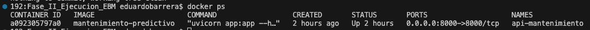
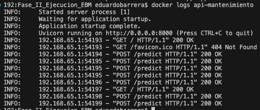
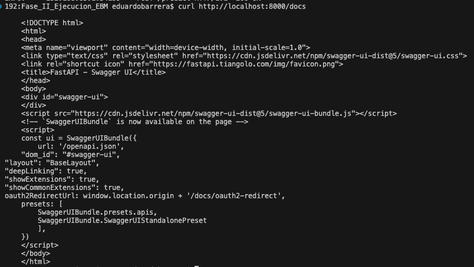
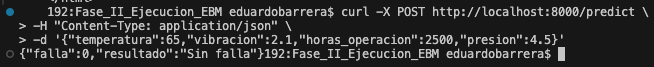
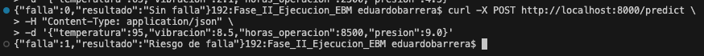
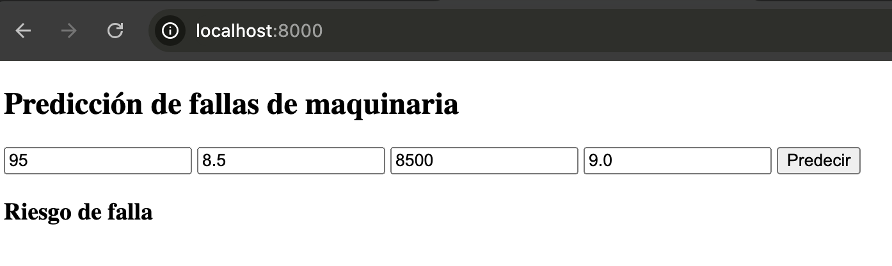
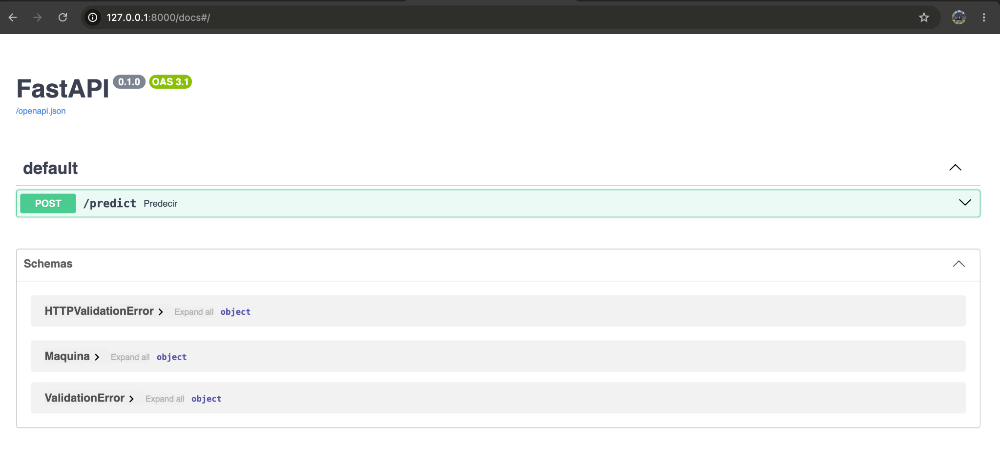

# Sistema de mantenimiento predictivo con Random Forest, FastAPI y Docker

## 1. Descripción y objetivo

El proyecto implementa una aplicación de **clasificación binaria de condiciones de riesgo de falla en maquinaria**. Se genera un dataset sintético, se entrena un único modelo **Random Forest**, se guarda el modelo y se consulta desde un formulario web conectado a una API **FastAPI**. La solución se empaqueta en **Docker** para facilitar su reproducción y ejecución local.

> **Alcance:** las etiquetas se construyen con reglas simuladas. El modelo no está validado para anticipar fallas reales ni sustituye un sistema industrial de seguridad.

## 2. Tecnologías y arquitectura

- **Python, NumPy y pandas:** creación y preparación de datos.
- **scikit-learn:** entrenamiento del clasificador Random Forest.
- **pickle:** almacenamiento y carga del modelo `.pkl`.
- **FastAPI y Uvicorn:** backend y API REST.
- **HTML y JavaScript:** frontend y consumo de la API con `fetch`.
- **Docker:** imagen y contenedor de ejecución.

```text
Navegador → GET / → frontend/index.html
                       │
                       └─ POST /predict (JSON)
                                  │
                              FastAPI (app.py)
                                  │
                        modelo_entrenado.pkl
                                  │
                    Respuesta: resultado
```

Frontend, backend y modelo se ejecutan dentro del **mismo contenedor**. El navegador accede al puerto 8000 del host, publicado hacia el puerto 8000 del contenedor.

## 3. Estructura del repositorio de GitHub

```text
proyecto_modelo/
├── frontend/
│   └── index.html                 # Formulario y llamada HTTP a la API
├── evidencias/
│   ├── 01-docker-ps.png
│   ├── 02-docker-logs.png
│   ├── 03-api-docs-html.png
│   ├── 04-prediccion-sin-falla.png
│   ├── 05-prediccion-con-falla.png
│   ├── 06-formulario-web.png
│   └── 07-fastapi-swagger.png
├── generar_dataset.py            # Generación del dataset sintético
├── dataset.csv                   # Datos generados
├── entrenar_modelo.py            # Entrenamiento y evaluación
├── modelo_entrenado.pkl          # Modelo serializado
├── app.py                        # Backend FastAPI y endpoints
├── requirements.txt              # Dependencias Python
├── Dockerfile                    # Construcción de la imagen
├── .dockerignore                 # Exclusiones del contexto Docker
├── .gitignore                    # Exclusiones del repositorio
└── README.md                     # Manual de reproducción y evidencias
```

**Contenido en repositorio** código fuente completo, `Dockerfile` funcional, archivos de configuración, modelo `.pkl` y evidencias de integración y ejecución local. La imagen se **reconstruye desde el Dockerfile**; no se almacena como archivo binario en Git.

## 4. Dataset sintético y reglas

El script `generar_dataset.py` produce **2,000 registros** con semilla aleatoria `42`:

| Campo | Rango de generación | Uso |
|---|---|---|
| `temperatura` | 40–120 °C | Entrada |
| `vibracion` | 0.1–10 mm/s | Entrada |
| `horas_operacion` | 100–9,999 h | Entrada |
| `presion` | 1–10 bar | Entrada |
| `falla` | 0 o 1 | Objetivo |

Se asigna `falla = 1` cuando se cumple **al menos una** condición: temperatura mayor a 90 °C; vibración mayor a 7 mm/s; o bien horas de operación mayores a 8,000 **y** presión mayor a 8 bar. En los demás casos, `falla = 0`.

```bash
python3 generar_dataset.py
```

Los límites son reglas didácticas, no criterios industriales validados.

## 5. Entrenamiento del modelo

El script `entrenar_modelo.py` separa los datos en **80 % entrenamiento y 20 % prueba** mediante `train_test_split(..., stratify=y, random_state=42)` y entrena `RandomForestClassifier(n_estimators=100, random_state=42)`.

```bash
python3 entrenar_modelo.py
```

Se genera `modelo_entrenado.pkl` con `pickle.dump`. Resultados observados sobre **400 registros de prueba**:

| Métrica | Resultado |
|---|---:|
| Accuracy | 1.00 |
| Precision (clase 1) | 1.00 |
| Recall (clase 1) | 1.00 |
| F1-score (clase 1) | 1.00 |
| Soporte clase 0 | 166 |
| Soporte clase 1 | 234 |

Estas métricas perfectas corresponden al conjunto sintético definido por reglas y **no demuestran desempeño con maquinaria real**.

## 6. Requisitos y dependencias

- Python 3 compatible con las dependencias del proyecto.
- Docker Desktop o Docker Engine **iniciado**.
- Puerto local **8000** disponible.
- `requirements.txt` con `fastapi`, `uvicorn`, `scikit-learn`, `pandas` y `numpy`. `pickle` no requiere instalación.

Para una reproducción consistente, fijar las **versiones reales** de las bibliotecas usadas al entrenar el `.pkl` y una imagen base Python compatible. Comprobar las versiones del entorno original:

```bash
python3 -c "import sys, sklearn, numpy, pandas, fastapi, uvicorn; print(sys.version); print('sklearn:', sklearn.__version__); print('numpy:', numpy.__version__); print('pandas:', pandas.__version__); print('fastapi:', fastapi.__version__); print('uvicorn:', uvicorn.__version__)"
```

Instalar las dependencias si se va a regenerar el dataset o el modelo fuera de Docker:

```bash
python3 -m pip install -r requirements.txt
```

> **Seguridad:** cargar archivos `.pkl` únicamente de fuentes confiables. Deserializar archivos pickle de origen desconocido puede ejecutar código.

## 7. Dockerfile funcional

El contenedor se construye a partir del siguiente Dockerfile:

```dockerfile
FROM python:3.11-slim
WORKDIR /app
COPY requirements.txt .
RUN pip install --no-cache-dir -r requirements.txt
COPY app.py .
COPY modelo_entrenado.pkl .
COPY frontend/ ./frontend/
EXPOSE 8000
CMD ["uvicorn", "app:app", "--host", "0.0.0.0", "--port", "8000"]
```

- `FROM`: define la imagen base.
- `WORKDIR`: establece el directorio de ejecución.
- `COPY` y `RUN`: incorporan los archivos e instalan dependencias.
- `EXPOSE`: documenta el puerto interno.
- `CMD`: inicia el servidor HTTP accesible desde fuera del contenedor.

El archivo `.dockerignore` puede excluir `__pycache__/`, `.git/`, `dataset.csv`, `generar_dataset.py` y `entrenar_modelo.py`, ya que el contenedor de inferencia solo necesita la API, el frontend, las dependencias y el modelo entrenado.

## 8. Reproducibilidad: ejecución local paso a paso

Los comandos siguientes se ejecutan desde la **raíz del repositorio**.

**A. Obtener el código** (sustituir por la URL real una vez publicado):

```bash
git clone URL_DEL_REPOSITORIO
cd proyecto_modelo
```

**B. Opcional: regenerar dataset y modelo** (si ya existe `modelo_entrenado.pkl`, no es necesario):

```bash
python3 -m pip install -r requirements.txt
python3 generar_dataset.py
python3 entrenar_modelo.py
```

**C. Verificar Docker y construir la imagen:**

```bash
docker info
docker build -t mantenimiento-predictivo .
```

**D. Ejecutar el contenedor:**

```bash
docker run -d -p 8000:8000 --name api-mantenimiento mantenimiento-predictivo
```

**E. Verificar estado y registros:**

```bash
docker ps
docker logs api-mantenimiento
```

**F. Abrir la aplicación:**

- Formulario: http://localhost:8000/
- Documentación interactiva FastAPI: http://localhost:8000/docs

**G. Detener y eliminar el contenedor cuando termine la prueba:**

```bash
docker stop api-mantenimiento
docker rm api-mantenimiento
```

Para reconstruir después de modificar archivos:

```bash
docker build -t mantenimiento-predictivo .
docker run -d -p 8000:8000 --name api-mantenimiento mantenimiento-predictivo
```

> Si ya existe un contenedor con ese nombre, detenerlo y eliminarlo antes de volver a ejecutar `docker run`. Si el puerto 8000 está ocupado, detener el servidor local anterior.

## 9. API e integración frontend/backend

| Método | Endpoint | Descripción |
|---|---|---|
| `GET` | `/` | Entrega el formulario HTML |
| `POST` | `/predict` | Recibe cuatro variables y devuelve la clasificación |
| `GET` | `/docs` | Documentación interactiva de FastAPI/Swagger UI |

El formulario envía una petición `POST /predict` con `Content-Type: application/json`. Ejemplo de cuerpo:

```json
{
  "temperatura": 95,
  "vibracion": 8.5,
  "horas_operacion": 8500,
  "presion": 9.0
}
```

Respuesta observada:

```json
{"falla": 1, "resultado": "Riesgo de falla"}
```

La API carga `modelo_entrenado.pkl` y utiliza el clasificador para generar la respuesta. FastAPI sirve el frontend desde la misma aplicación, por lo que la petición `fetch('/predict')` utiliza el mismo origen y no requiere configurar CORS para esta arquitectura.

## 10. Pruebas funcionales realizadas

### 10.1 Contenedor en ejecución

Se verificó mediante `docker ps` que `api-mantenimiento` estaba **Up** y publicaba `0.0.0.0:8000->8000/tcp`.



### 10.2 Registros de la aplicación

`docker logs api-mantenimiento` mostró el arranque correcto de Uvicorn y solicitudes `GET /`, `GET /docs` y `POST /predict` con respuestas `200 OK`. En los registros también apareció un `404` inicial en `/` antes de incorporar el frontend, posteriormente corregido.



### 10.3 Documentación de la API por HTTP

`curl http://localhost:8000/docs` devolvió el HTML de Swagger UI, confirmando que el endpoint de documentación estaba disponible.



### 10.4 Predicción sin falla

```bash
curl -X POST http://localhost:8000/predict \
  -H "Content-Type: application/json" \
  -d '{"temperatura":65,"vibracion":2.1,"horas_operacion":2500,"presion":4.5}'
```

Respuesta obtenida:

```json
{"falla":0,"resultado":"Sin falla"}
```



### 10.5 Predicción con riesgo de falla

```bash
curl -X POST http://localhost:8000/predict \
  -H "Content-Type: application/json" \
  -d '{"temperatura":95,"vibracion":8.5,"horas_operacion":8500,"presion":9.0}'
```

Respuesta obtenida:

```json
{"falla":1,"resultado":"Riesgo de falla"}
```



### 10.6 Formulario web integrado

La interfaz disponible en `http://localhost:8000/` recibió las cuatro variables y mostró **«Riesgo de falla»**, evidenciando la comunicación entre frontend, API y modelo.



### 10.7 Interfaz de FastAPI / Swagger UI

La documentación interactiva mostró el endpoint `POST /predict` y el esquema de entrada `Maquina`, permitiendo inspeccionar y probar el contrato de la API.



## 11. Resumen

| Entregable | Evidencia o archivo |
|---|---|
| Código fuente completo | Scripts Python, `app.py`, `frontend/index.html` |
| Dockerfile funcional | `Dockerfile` |
| Archivos de configuración | `requirements.txt`, `.dockerignore`, `.gitignore` |
| Integración frontend/backend | Formulario, `POST /predict`, FastAPI `/docs` |
| Imagen Docker construida | `docker build` y contenedor `mantenimiento-predictivo` |
| Ejecución local | `docker ps`, `docker logs`, `curl` y navegador |
| Reproducibilidad | Comandos de instalación, entrenamiento, build y run |
